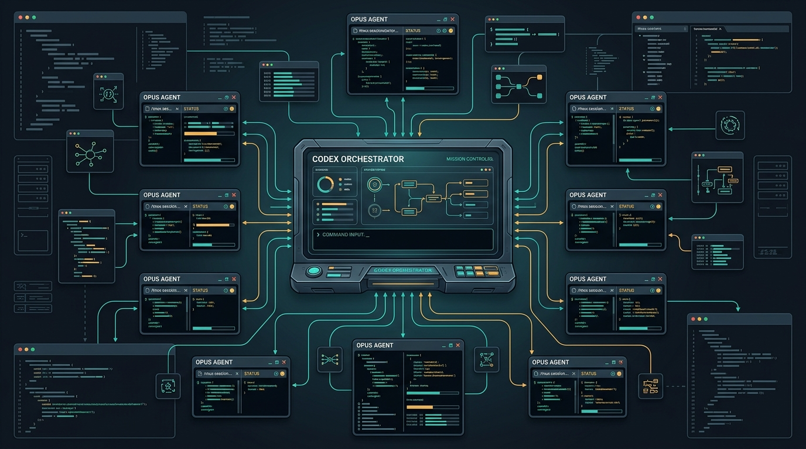

# claude-agent

`claude-agent` is a small tmux-backed orchestration CLI for Claude Code sessions. It gives any terminal process the same basic control loop as `codex-agent`: start a background agent, wait for a turn, capture bounded output, send follow-ups, and stop the session cleanly.



## What It Does

- Starts one Claude Code session per tmux job.
- Writes per-job state under `~/.claude-agent/jobs`.
- Uses Claude Code `Stop` and `StopFailure` hooks to power `await-turn`.
- Captures live panes and persisted transcripts.
- Exposes a local HTTP service so other CLIs can manage jobs.
- Ships an `opus-agent-orchestrator` skill for Codex/Claude workflows.

## Defaults

```text
model: opus
effort: max
permission mode: auto
service: 127.0.0.1:4877
```

For broad design exploration, use `--xhigh` to reduce spend while keeping strong frontend reasoning. For the final hard pass, use the default `max`.

## Install

Requirements:

- Bun
- tmux
- Claude Code CLI

```bash
git clone https://github.com/kingbootoshi/claude-agent.git
cd claude-agent
bun install
mkdir -p ~/.local/bin
ln -sf "$PWD/bin/claude-agent" ~/.local/bin/claude-agent
```

Make sure `~/.local/bin` is on `PATH`.

## Health And Auth

`claude-agent` uses your local Claude Code authentication. It stores job metadata and a service bearer token, but it does not copy Claude credentials.

```bash
claude-agent health
claude-agent auth status
claude-agent auth login
```

## Standard Loop

```bash
claude-agent start "Explore the auth module and report the key flows." \
  --dir /path/to/repo \
  --map \
  --xhigh \
  --permission-mode plan

claude-agent await-turn <jobId>
claude-agent capture <jobId> 160 --clean
claude-agent send <jobId> "Now focus on the token refresh path."
claude-agent await-turn <jobId>
claude-agent capture <jobId> 220 --clean
claude-agent send <jobId> "/exit"
```

`await-turn` blocks until the Claude Code stop hook fires, the job ends, or the process is interrupted. This is the main feature that keeps orchestration context efficient: wait for the turn, then capture only the lines you need.

## Commands

```bash
claude-agent start "prompt" [options]
claude-agent status <jobId>
claude-agent await-turn <jobId>
claude-agent send <jobId> "message"
claude-agent capture <jobId> [lines] [--clean]
claude-agent output <jobId> [--clean]
claude-agent jobs [--json] [--all]
claude-agent sessions
claude-agent attach <jobId>
claude-agent watch <jobId>
claude-agent kill <jobId>
claude-agent clean
claude-agent health
claude-agent auth <status|login|setup-token>
claude-agent service <start|token|rotate-token>
```

Common options:

```bash
--model <model>
--effort <low|medium|high|xhigh|max>
--max
--xhigh
--permission-mode <default|acceptEdits|plan|auto|dontAsk|bypassPermissions>
--dir <path>
--map
--claude-path <path>
--wait
--dry-run
```

## Local Service

Start the service:

```bash
claude-agent service start --host 127.0.0.1 --port 4877
```

Create a job from another CLI:

```bash
TOKEN="$(claude-agent service token)"

curl -sS -H "Authorization: Bearer $TOKEN" \
  -H "content-type: application/json" \
  -d '{"prompt":"Review this UI brief and propose implementation risks","cwd":"/path/to/repo","effort":"xhigh","permissionMode":"plan"}' \
  http://127.0.0.1:4877/jobs
```

Wait for a turn and capture output:

```bash
curl -sS -X POST -H "Authorization: Bearer $TOKEN" \
  "http://127.0.0.1:4877/jobs/<jobId>/await-turn?timeoutMs=300000"

curl -sS -H "Authorization: Bearer $TOKEN" \
  "http://127.0.0.1:4877/jobs/<jobId>/capture?lines=160&clean=true"
```

Endpoints:

- `GET /health`
- `GET /jobs`
- `POST /jobs`
- `GET /jobs/:id/status`
- `GET /jobs/:id/capture?lines=120&clean=true`
- `GET /jobs/:id/output?clean=true`
- `POST /jobs/:id/send`
- `POST /jobs/:id/await-turn?timeoutMs=300000`
- `POST /jobs/:id/kill`

## Workbench Pattern

Use this shape for frontend variant exploration:

```bash
claude-agent start "Read apps/workbench/AGENT_DESIGN_RULES.md, src/generated/theme-summary.md, and the target brief.md.

Create v1-v5 as distinct React/Tailwind variants that obey the variant contract.
Run the workbench check and fix violations.
Report the files changed and the visual direction of each variant." \
  --dir /path/to/repo \
  --xhigh \
  --permission-mode auto
```

Then inspect:

```bash
claude-agent await-turn <jobId>
claude-agent capture <jobId> 160 --clean
```

## Skill

The repo includes `opus-agent-orchestrator` skill files:

- `skills/codex/opus-agent-orchestrator/SKILL.md`
- `skills/claude/opus-agent-orchestrator/SKILL.md`

Install them manually by copying the relevant folder into your local skills directory:

```bash
mkdir -p ~/.codex/skills ~/.claude/skills
cp -R skills/codex/opus-agent-orchestrator ~/.codex/skills/
cp -R skills/claude/opus-agent-orchestrator ~/.claude/skills/
```

## Public Safety Notes

This repository is designed to be public-safe:

- No credentials are stored in the repo.
- Runtime state lives under `~/.claude-agent`, which is ignored.
- Service tokens are generated locally and ignored.
- `node_modules` is ignored.
- Examples use placeholder paths.
